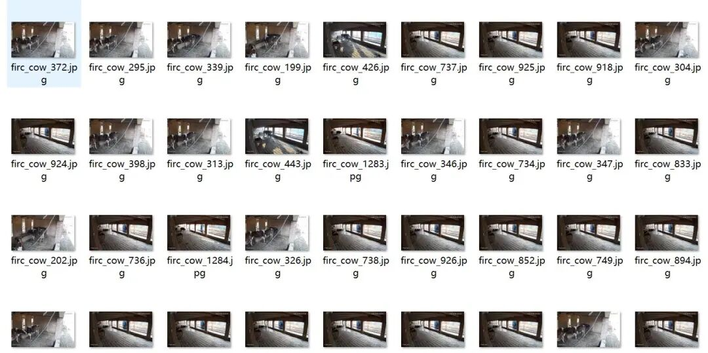
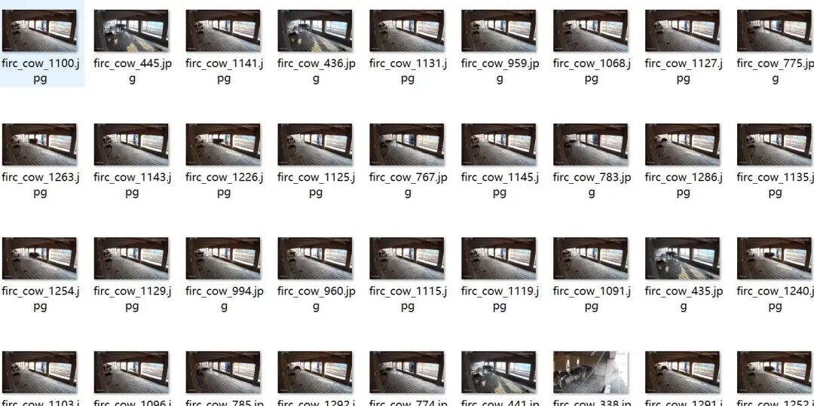
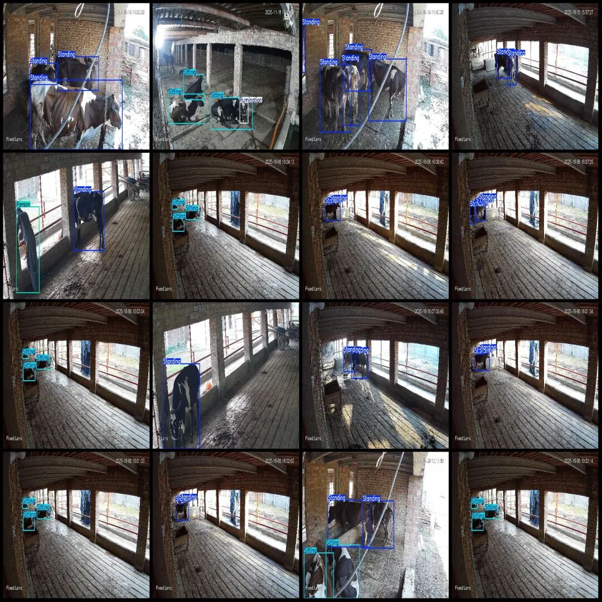
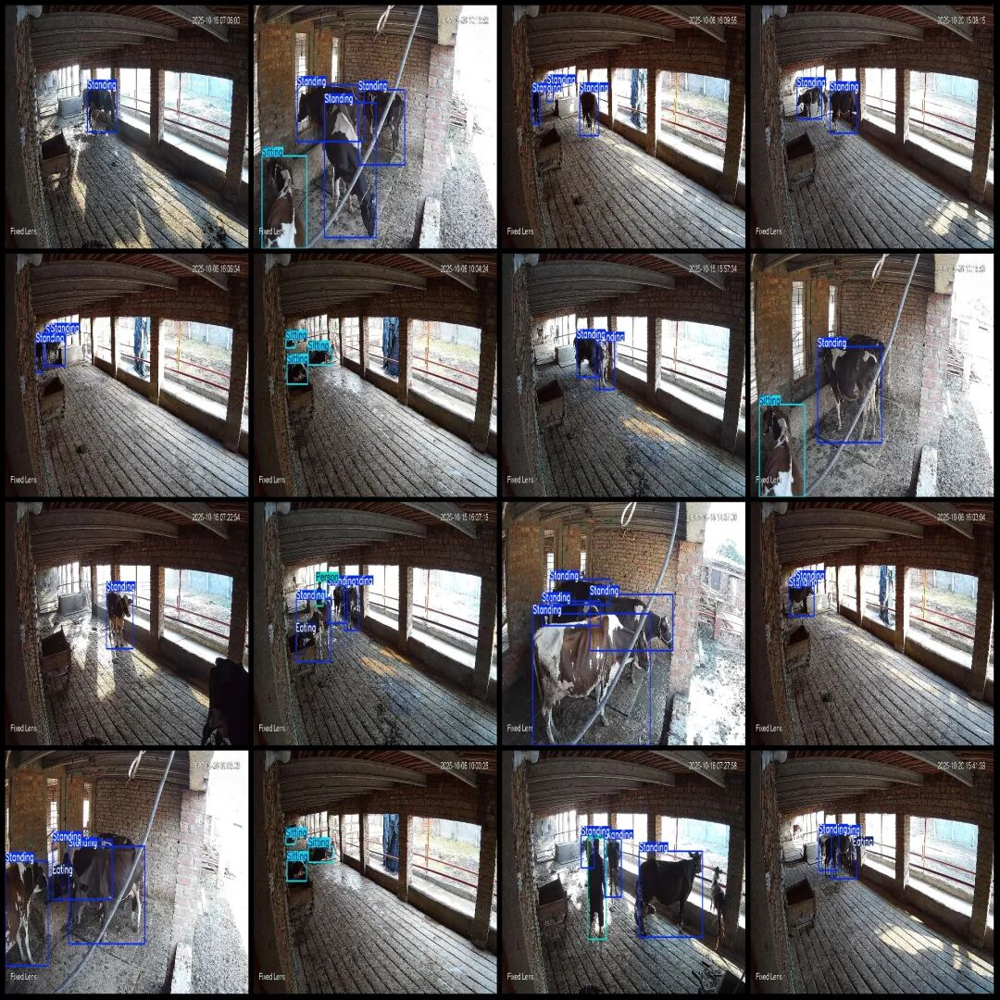

# Intelligent Beef Detection Data Set - VOC+YOLO Format: 2113 Images, 5 Categories

Dataset format: Pascal VOC format + YOLO format (txt file without split path, only containing jpg images and corresponding VOC format xml files and yolo format txt files)

Number of images (number of jpg files): 2113

Number of annotations (number of xml files): 2113

Number of annotations (number of txt files): 2113

Label category count: 5

Label category names (note that the order of yolo format categories does not correspond to this, but is based on the labels folder's classes.txt): ["Eating", "Person", "Rumination", "Sitting", "Standing"]

Number of boxes labeled in each category:

Eating Frames = 727

Person Frames = 248

Rumination Frames = 104

Sitting Frame Count = 829

Standing Frame Count = 5005

Total frame count: 6913

Number of images per category:

Eating (eat) occupies a picture count = 641

Person (person) occupies the number of pictures = 211

Rumination (regurgitation) occupies a picture count = 100

Sitting (sit) occupies a picture count = 338

Standing (stand) occupancy = 1880

Image resolution: 1920x1080

Using labelImg:

Annotation rules: Draw a rectangle around the category.

Important Notice: The dataset does not have separate training, validation, and test sets; you need to partition them yourself.

Special : This dataset does not guarantee the accuracy of the trained models or weight files.

Image Preview:

Annotation example:

## Payment

Here is a pay link on Stripe ( https://buy.stripe.com/3cs8yP7sY87d0vu9AB ). Please contact me lonlonago@foxmail.com after funding $89, and I will send you a complete data files , thank you!

